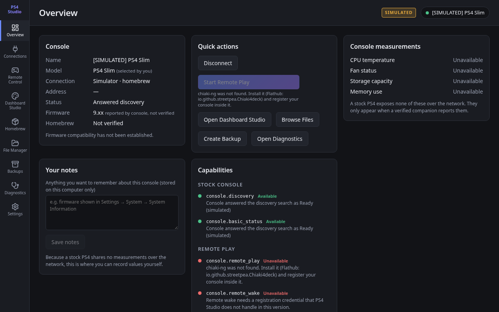
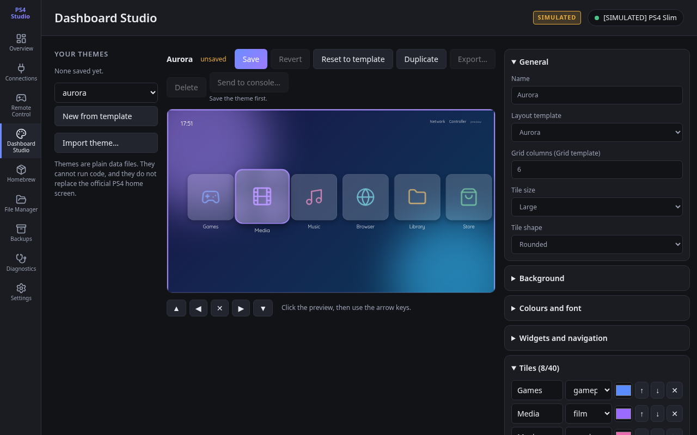
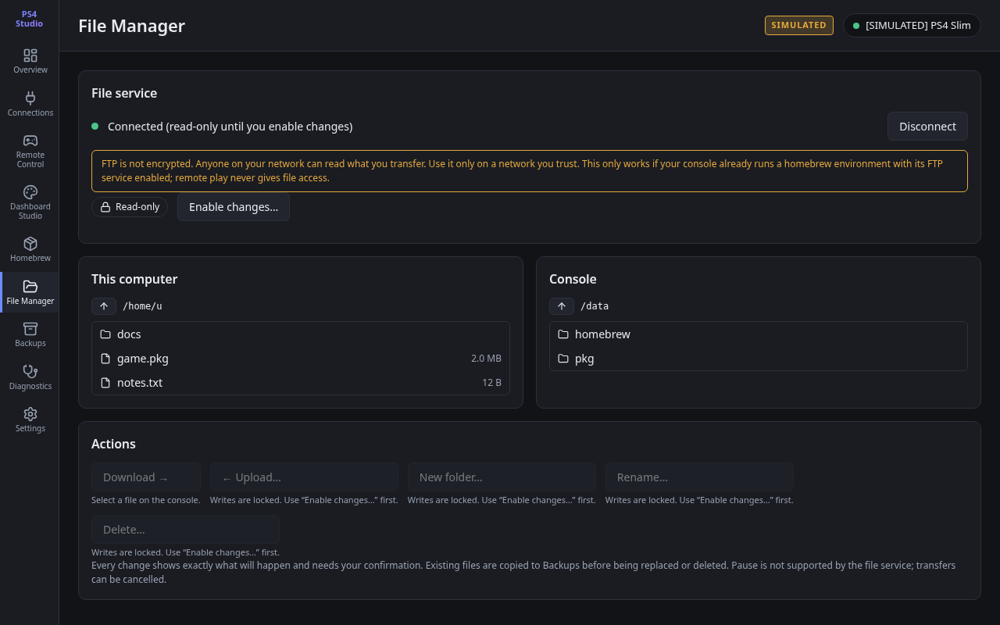
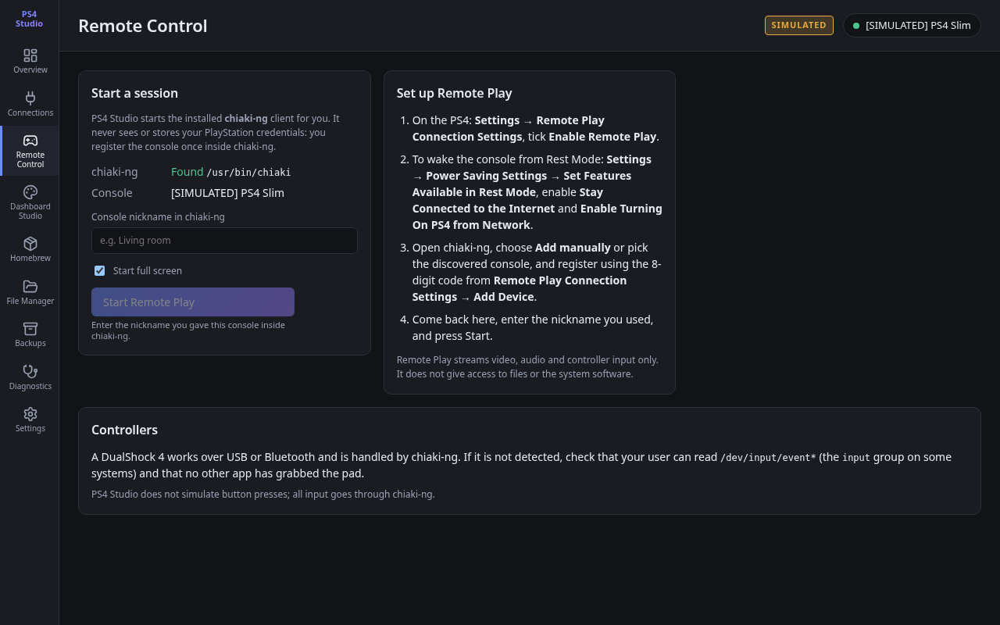

# PS4 Studio

An open-source Debian desktop app for managing a PlayStation 4 over your local network and designing console-style dashboards. Built with Rust, Tauri 2 and Svelte 5.

**Project page:** [mikeholp87.github.io/PS4-Studio](https://mikeholp87.github.io/PS4-Studio/)

> **Independent project.** PS4 Studio is not affiliated with, endorsed by, or sponsored by Sony Interactive Entertainment. "PlayStation" and "PS4" are trademarks of their owners and are used only to describe compatibility. The app ships its own original icon and design; it contains no Sony assets.

> **Honest status (v0.1.0).** Everything has been developed and tested against a built-in **simulator** and automated tests. **No physical PS4 has been used.** Features that need a console are marked below as *simulator-verified*. The PS4-side companion app is an **untested source skeleton**.

| | |
|---|---|
|  |  |
|  |  |

*(Screenshots show the real UI driven by simulator fixtures, not a real console.)*

## What it does
| Area | Works on a stock PS4? | Status |
|---|---|---|
| **Dashboard Studio** – design/preview/export console-style themes (Minimal, Aurora, Grid, Classic), 1080p TV preview, keyboard/gamepad navigation | n/a (desktop only, offline) | working |
| **Offline simulator** – 14 scenarios (offline, pairing required, FTP failure, interrupted transfer, companion mismatch, …) with real UDP/FTP/companion servers | n/a | working |
| **Discovery & status** (UDP 987) | yes, if the console answers | implemented per chiaki-ng wire format; simulator-verified |
| **Remote Play** – launches your installed [chiaki-ng](https://github.com/chiaki-ng/chiaki-ng) as a separate process | yes (needs chiaki-ng + Remote Play enabled) | implemented; tested with a fake binary only |
| **File Manager / Homebrew / Backups** | **No** – only for consoles that *already* run a homebrew environment with its FTP service enabled | read-only by default; every change is planned, confirmed, backed up and audited; simulator-verified |
| **Companion** (theme transfer to a PS4 app) | No – homebrew only | protocol verified (Rust + C); console app untested |
| **Diagnostics** – checks, sanitised report export | yes | working |
| **Console UI simulation** (experimental) | n/a | demo only |

### What PS4 Studio will never do
Install exploits or change firmware, run payloads, give remote shell access, handle your PSN credentials, bypass DRM or bans, or download games/packages. **Remote Play gives video and controller input only: it does not give file access, and HDMI gives no access to the console's operating system.** Changing a theme does **not** replace the official PS4 home screen.

## Install (Debian)
```sh
# from a release .deb
sudo apt install ./ps4-studio_0.1.0_amd64.deb
```
Runtime needs `libwebkit2gtk-4.1` and GTK 3 (pulled in automatically). It runs as a normal user; no root is needed. See [docs/installation.md](docs/installation.md) (also AppImage/Flatpak notes and build from source).

Data locations (XDG): config `~/.config/ps4-studio`, data `~/.local/share/ps4-studio` (database, themes, backups, reports), cache `~/.cache/ps4-studio`.

## Quick start
1. Open the app; try **Connections → Offline simulator** to explore without a console.
2. **Dashboard Studio** works offline: pick a template, edit, save, export.
3. For a real console: **Connections → Search local network** or add the IP; press **Connect**.
4. **Remote Play**: install chiaki-ng ([Flathub](https://flathub.org/apps/io.github.streetpea.Chiaki4deck)), register your console inside it once, then enter its nickname in **Remote Control**.
5. Homebrew/file tools need a console that already runs a homebrew environment (see below). Nothing is installed or exploited by this app.

## Supported consoles & firmware
The model is *your* selection (PS4, Slim, Pro). PS4 Studio **does not assert any firmware range**: stock features depend on chiaki-ng, and homebrew features depend on the environment you set up yourself. Firmware shown in the app is `unknown`, `reported by the console (coarse)` or `entered by you`, never "verified". See [docs/firmware-compatibility.md](docs/firmware-compatibility.md).

## Homebrew requirements
File/homebrew features need an existing, user-enabled FTP service (the GoldHEN README documents port 2121). Capabilities are enabled only by a real FTP handshake and listing, never by an open port. FTP is **unencrypted**: use it on a trusted network. Writes are limited to `/data` and unlocked per session; system trees are always read-only. Details: [docs/security.md](docs/security.md).

## Dashboard customization
Themes are plain JSON files validated against one JSON Schema (`packages/theme-engine/theme.schema.json`): no scripts, no URLs, no external assets. Import/export through the Studio. Templates are original designs.

## Development
```sh
pnpm install
cd apps/desktop/src-tauri && cargo tauri dev          # run the app
cargo fmt --check && cargo clippy --workspace --all-targets -- -D warnings && cargo test --workspace
pnpm -r check && pnpm -r lint && pnpm -r test
cd apps/desktop && pnpm e2e                           # Playwright (see docs/development.md)
make -C apps/ps4-companion host-test                  # portable C protocol core
```
Architecture and agent-handoff docs: [docs/architecture.md](docs/architecture.md), [AGENTS.md](AGENTS.md), [docs/current-status.md](docs/current-status.md).

## Security warnings
FTP and the companion link are not encrypted. Homebrew carries risk to your console and account. Back up with Sony's own tools before experimenting. Report vulnerabilities per [SECURITY.md](SECURITY.md).

## Troubleshooting
See [docs/troubleshooting.md](docs/troubleshooting.md).

## Roadmap
Verify against real hardware (discovery, Remote Play launch, FTP), build/test the OpenOrbis companion on a compatible console, Secret Service storage for optional persisted logins, AppImage/Flatpak, Android/Google TV (ADB) module, standalone kiosk "console mode". See [docs/tasks.md](docs/tasks.md) and [docs/alternative-os-roadmap.md](docs/alternative-os-roadmap.md).

## License
GPL-3.0-or-later (see [LICENSE](LICENSE)). Third-party licenses: [docs/dependencies-and-licenses.md](docs/dependencies-and-licenses.md).
